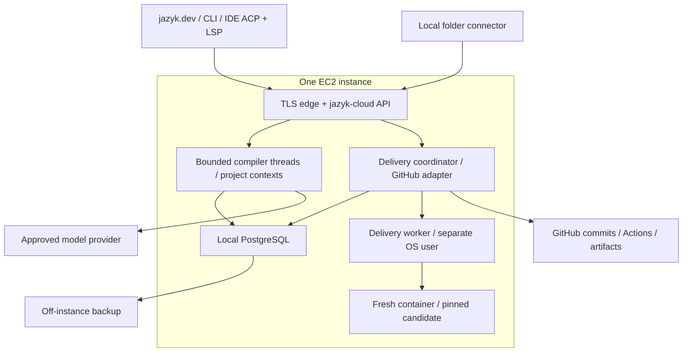

# Cloud server architecture

Status: proposed, 2026-10-03. The deployment target is one EC2 instance. The compiler
remains a library with explicit project contexts and no required project filesystem.

## Host options

| Option | Benefits | Costs | Decision |
|---|---|---|---|
| Node.js wrapper starting `jazyk` processes | Familiar web integrations; quick single-project experiment | IPC, process supervision, repeated state, harder shared transactions; still needs storage isolation | Do not use as the foundation |
| Add accounts and cloud routes to the customer `jazyk` | Reuses local HTTP server directly | Commercial dependencies and host privileges enter the distributed binary; current state assumes one project | Reject the dependency boundary |
| Separate Rust host linking compiler and delivery libraries | Shared contracts, one multi-project API process, existing Axum experience | Requires instance storage and removal of ambient state first | Recommended |
| Rust API plus remote compiler workers | Separate scaling and failure domains | More transport and operations before demand | Keep an interface for later |

`jazyk-cloud` is the application web server. A small standard TLS reverse proxy may
sit in front of it. There is no Node.js business-logic wrapper. The existing static
jazyk.dev app talks to the local or cloud project API.

## One host, separate privileges



One API process serves many projects. The delivery worker can be another subcommand
of the same cloud executable, run by systemd as a separate OS user. It has narrow
job capabilities and container access, no account database password or GitHub App
private key. PostgreSQL and the container daemon are separate existing services.
One cloud binary does not mean one OS process for all infrastructure.

The API holds durable intent and receives worker events over an authenticated local
socket or loopback connection. The runner contract must also work over an outbound
authenticated remote connection. Changing runner placement is a deployment choice.

## Library and package split

Current [Cargo.toml](../../bootstrap/Cargo.toml) already exposes an `rlib` and WASM
library. [main.rs](../../bootstrap/src/main.rs) is a thin launcher. This is a useful
starting point, but the library also contains native CLI and GUI modules. Linking
it unchanged would not create a clean cloud boundary.

Proposed dependency direction:

```text
jazyk CLI / local bridge / WASM    jazyk-cloud API + adapters
               \                    /
           portable project service + protocol contracts
                    |             |
              compiler core   delivery consumer
                    \             /
             workspace/state/evidence interfaces
```

- Extract a compiler core with graph, reconciliation, tools, context, rendering,
  and storage interfaces. No account, database, HTTP listener, or payment imports.
- Keep protocol/service contracts transport-neutral. Reuse the value computations
  in [webapi](../../bootstrap/src/webapi/mod.rs) after making context explicit.
- Keep generic delivery configuration, preparation, evidence, and checkpoint rules
  in a consumer library. Cloud GitHub credentials and worker placement stay outside.
- Keep native CLI, local filesystem adapters, ACP/LSP stdio, and the small loopback
  GUI connection in the customer package. Existing `jazyk gui` remains compatible.
  A lightweight local HTTP bridge is still necessary for jazyk.dev to use a folder.
- Put the cloud binary and SQL, OAuth, Stripe, GitHub, and runner adapters under
  `cloud/`. They depend inward on the public libraries. Core never depends on cloud.
- Keep `bootstrap/app/` initially. Avoid a cosmetic web-directory move in this work.

First use explicit Cargo features and separate host crates to cut dependency cycles.
Extract core/consumer crates as the interfaces settle. Compile a customer artifact
without cloud dependencies and a WASM artifact without native host dependencies as
acceptance gates. This avoids requiring an all-at-once source-tree relocation.

Use maintained crates for TOML, HTTP, OAuth, Git, SQL, archives, and runtime clients.
The current handwritten TOML reader must not grow into a new general parser to
support editable deliveries. Use a lossless TOML editing library and schema validation.

## Shared compiler

Inject a `ProjectContext` containing authorized project identity, capabilities,
workspace revision, state store, graph generation, writer epoch, model session
factory, budget, cancellation, and event/artifact sinks.

The current [GUI state](../../bootstrap/src/gui/state.rs) fixes a root per process.
The [VFS](../../bootstrap/src/vfs.rs) selects native disk or a thread-local browser
tree. The [LLM client](../../bootstrap/src/llm.rs) keeps process-wide fallback flags,
pacing, and counters. Replace these assumptions before sharing one process among
customers. Thread-local tenant selection is not sufficient for async work.

- Different projects can run concurrently through a bounded compiler worker pool.
- One build and one automated session at a time per project. Keep existing graph
  gates, goals, identity, provenance, journals, and no-op compilation behavior.
- A project writer lease has a fencing epoch. Every graph commit checks it.
- No ambient cwd, customer environment variables, arbitrary provider URL, host shell,
  customer plugin, or executable setup hook in hosted compilation.
- An agent that requires native project tools is not admitted to hosted compilation.
  Do not start a hidden container to work around this. Runtime exists for delivery.
- Compile and artifact-only generation can operate on virtual files. Any test run
  is an explicit delivery operation. Generation needing execution pauses for that
  operation and resumes from its evidence.

Tenant/project identity scopes tools, handles, caches, conversations, artifacts,
events, and secret references. The host resolves authorization before constructing
a context. Model instructions never substitute for these checks.

## API and protocol surface

Expose project sessions, revisioned files, graph views, compiler jobs, deliveries,
delivery attempts, run files, and sequenced events. Use a common project service
from HTTP, MCP, ACP, CLI, and GUI adapters rather than calling HTTP from core code.

Illustrative routes:

```text
/api/projects/:project/workspace
/api/projects/:project/jobs
/api/projects/:project/deliveries
/api/projects/:project/delivery-attempts
/api/projects/:project/delivery-attempts/:attempt/events
/api/projects/:project/delivery-attempts/:attempt/files
```

Use SSE for reconnectable progress/logs and WebSocket where a protocol needs duplex
messages. Authorize each request and subscription; opaque ids alone grant nothing.
Idempotency keys return the original job/attempt. Passive LSP reads spend no model
credits. Explicit inference actions reserve credits through the cloud host.

Retain the [ACP/LSP mapping](../subscription/protocols.md): the local connector maps
IDE file URIs to virtual paths, forwards ACP, and commits versioned edits. Remote
LSP is not a whole-project synchronization protocol. Virtual cloud browsing needs
an IDE integration or explicit checkout/export. Delivery operations appear as ACP
tools/progress and MCP tools; LSP links their evidence without becoming a job runner.

## Specification ownership

Before implementation, put accepted contracts into `docs/compiler/` (contexts and
storage), `docs/consumers/delivery.md` (delivery semantics), `docs/frontends/`
(protocols and commands), `docs/web/` (project/delivery UI), and `docs/cloud/`
(accounts, PostgreSQL, GitHub, billing, runtime, operations). Link them from
`docs/main.md`. Compiler extraction must not require extracting the commercial host.
