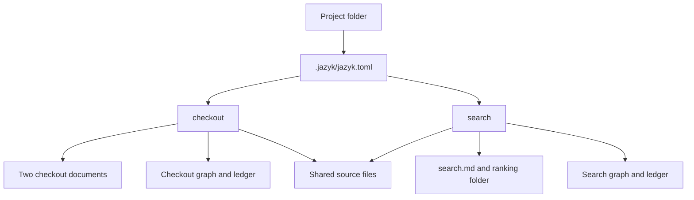

# Plan: document sets in one project

Status: the document-set core was released on 2026-10-07. The original design below
records its decisions. [Implementation and release](./implementation.md) records
completion. [Word and PDF import](./import.md) is the proposed next milestone.

This plan supersedes [workspaces, specs, and mappings](../workspaces-and-mappings.md)
for project configuration, independent compilation, and frontend scope. That older
proposal remains background for use cases outside this delivery.

## The result

Open any folder. Add a named document set, e.g. `feature-xyz`, select its documents,
and optionally select the source files it describes. Add another set without
changing the first. See both in one project, compile either, or compile all dirty
sets with one action.

- [Engine and contracts](./engine.md): configuration, matching, stores, scheduling,
  API, CLI, ACP, LSP, and compatibility.
- [Editor experience](./editor.md): setup, Document sets, file markings, compilation,
  ongoing management, and later document imports.
- [Implementation sequence](./implementation.md): repository ownership, ordered
  changes, and acceptance cases.
- [Word and PDF import](./import.md): conversion, review, origin records, re-import,
  storage prerequisites, and phased delivery.

## Decisions

| Subject | Proposed decision |
|---|---|
| Project | The folder the user opens. One project can contain zero or more document sets. |
| Configuration | One `.jazyk/jazyk.toml` at the project root. Paths resolve from the project folder. |
| Named unit | A **document set**. Its name can be a feature, subsystem, policy, or anything the user chooses. |
| Documents | One or more files or globs per set, with exclusions. No required docs directory. |
| Source | Optional files or globs per set. Different sets can describe the same source files. |
| Compilation | One persistent graph, ledger, board, and verdict per set. |
| Identity | An immutable set ID, separate from its editable display name. |
| Presentation | One Files tree plus a Document sets navigator. Both describe the same project. |
| Visibility | All sets load together. Filtering a view never changes a process-wide active set. |
| Compile | A split button for all dirty sets or one named set. Execution stays sequential. |
| Setup | Opening an unconfigured folder reads it. Saving the first set creates configuration. |
| Import | Markdown first. Word/PDF conversion later, through the same add-document flow. |

“Source” in the editor means implementation or product files, as in the user's
request. The compiler still calls its output the deliverable. This plan does not
limit Jazyk to software. A document set may describe a book or have no linked source.

Document sets are independent semantic contexts. Their graphs do not share nodes,
run contradiction checks against each other, or create cross-set relationships.
Documents that must agree in one semantic model belong to the same set. Ordinary
Markdown links across sets remain navigable without importing their content into
the other graph.

## Example

```text
shop/
  .jazyk/
    jazyk.toml                 shared configuration, committed
    .gitignore                 generated state exclusions, committed
    ds_checkout/               checkout graph and runtime state
    ds_search/                 search graph and runtime state
  docs/
    checkout.md
    checkout-errors.md
    search.md
  docs-feature-search/
    ranking.md
  src/
    checkout/
    search/
    shared/
  tests/
    checkout/
    search/
```

```toml
version = 1

[[sets]]
id = "ds_checkout"
name = "checkout"
docs = ["docs/checkout.md", "docs/checkout-errors.md"]
roots = ["docs/checkout.md"]
source = ["src/checkout/**", "src/shared/**", "tests/checkout/**"]

[[sets]]
id = "ds_search"
name = "search"
docs = ["docs/search.md", "docs-feature-search/**/*.md"]
roots = ["docs/search.md"]
source = ["src/search/**", "src/shared/**", "tests/search/**"]
```

The IDs above are readable examples. Creation mints stable opaque IDs. Neither
the name nor the position of a set in the config determines its store identity.



Opening `shop/` shows both sets. Editing `checkout-errors.md` makes only checkout
need compilation. Editing `src/shared/` invalidates relevant source evidence in
both sets. It does not merge their graphs or automatically rewrite their docs.

## Scope

The first release includes configuration inside `.jazyk`, multiple independent
sets, arbitrary in-project document and source selections, combined visibility,
per-set and all-dirty compilation, and equivalent agent/IDE operations.

Later work includes Word/PDF conversion, external filesystem mounts, cross-set
semantic reasoning, automatic splitting or merging of existing graphs, and
parallel compilation. None is required to add several feature documents today.

The current [project settings](../../docs/compiler/project-settings.md),
[graph store](../../docs/compiler/graph.md),
[local API](../../docs/frontends/gui.md), and
[editor protocol](../../docs/frontends/protocol.md) are the baseline. This plan
changes them through the docs-first sequence in [implementation](./implementation.md).
