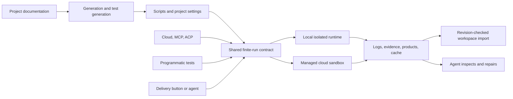

# Runtime and delivery plan

Status: discussion draft, 2026-10-14. No implementation is authorized by this
document. Proposed configuration and tool names are illustrative. Accepted behavior
must enter `docs/` before code.

The owner selected managed isolated runtimes with little operational work as the
preferred Cloud launch direction. The owner also selected finite action runs and
Runs beside Files in the existing tabs. Cloud, local MCP coding agents, and ACP
IDE sessions must all access the same execution contract. Delivery autonomy remains
an open decision.

## Proposed direction

Give Jazyk one execution contract for local and hosted use. Generation, test
generation, programmatic verification, linting, and delivery all use it. A project
describes its intended product and delivery in prose. The model generates ordinary
scripts and a small project configuration that points to them.

A delivery can build a PDF, EPUB, presentation, application, container image, or
anything else its script can produce or publish. Jazyk understands the execution
environment, files, resource bounds, and result. It does not need a registry of
product types or destination types. A GitHub push is the one built-in shortcut
that needs no project runtime.

The minimum ordinary delivery is a name and script, using a default image. An
image override is optional. Cache paths and retained products are optional. Named
tasks and ordered steps are available only when a project needs reuse or explicit
checkpoints. An ordinary project should not need a CI workflow language.

Each action gets a fresh container, runs its complete script or frozen steps,
retains logs and file changes, and shuts down. The agent inspects those results,
repairs the project, and starts another run when needed. There are no interactive
containers, manual command consoles, or live deadline extensions. This resembles
GitHub Actions' execution model without requiring GitHub as the backend.

## Recommendations to review

- Use the same action, snapshot, log, file import, and evidence contracts locally
  and remotely. Default local execution to Docker or Podman. Offer direct host
  execution as an explicit trusted mode, with its different isolation shown.
- Compare managed batch/container execution and sandbox services against the finite
  run contract. AWS Fargate is now a direct contender alongside Modal and E2B.
- Start with one active execution run per project, using a fresh container.
  Different projects may run concurrently within account and service limits.
- Give the agent tools to define, submit, observe, and cancel actions, select tests,
  inspect retained logs/diffs, and start revised attempts within a cumulative budget.
- Freeze each run's inputs and steps. Import source changes and products at declared
  checkpoints with revision checks. Do not mirror the entire sandbox into the
  canonical project on every filesystem event.
- Keep products durably, keep caches opportunistically, and discard unclassified
  new files. Existing project files remain canonical inputs. Logs and test evidence
  are retained operational records, independent of those file classes.
- Charge runtime use into the existing monthly, five-hour, and seven-day usage
  limits using resource cost, not pretend LLM tokens. Show used and reserved usage.
- Put a collapsible `Runs` group beside Files in the existing sidebar. Each run
  opens a normal tab with logs, steps, retained file changes, and products. This is
  an accepted layout choice. Container teardown happens automatically.
- Keep external publication policy separate from model-editable configuration.
  [Autonomy options](decisions.md#delivery-autonomy) remain open.

## Reading order

| File | Discussion |
| --- | --- |
| [Current state](current-state.md) | What exists and what this proposal replaces. |
| [Configuration](configuration.md) | Minimal definitions, reusable tasks, examples, GitHub sync. |
| [Runtime](runtime.md) | Local and Cloud execution, tools, lifecycle, limits, isolation. |
| [Cloud, MCP, and ACP](access-paths.md) | Shared operations, IDE updates, routing, cancellation, reconnect. |
| [Generation and tests](generation-testing.md) | Agent loop, test selection, evidence, LLM verification. |
| [Agent tools and prompts](agent-contract.md) | Phase-specific toolsets, draft payloads, autonomy, and evaluations. |
| [Files and storage](files-storage.md) | Products, caches, scratch files, snapshots, logs, retention. |
| [Providers](providers.md) | Managed options, indicative costs, security, selection experiment. |
| [Billing](billing.md) | Reservations, settlement, rolling limits, trials, UI. |
| [Editor](editor.md) | Deliver button, Runs, logs, retained changes, local and IDE access. |
| [Decisions](decisions.md) | Alternatives and questions for our next review. |
| [Implementation](implementation.md) | Docs-first sequence, repository ownership, acceptance scenarios. |

## Relationship to earlier plans

This draft proposes replacing the GitHub Actions-only execution direction in the
[earlier delivery plan](../delivery/README.md). That plan's destination checkpoints,
preservation obligations, and uncertain external outcomes remain useful. They do
not become mandatory configuration for a script that simply produces a file.

Delivery is an operation on a selected project revision. Running one does not make
new compiler goals or alter the sequential goal scheduler. The harness continues
to own goals, gates, identity, and graph commits. A finite action is a tool used
while doing authorized work, not a second compiler scheduling system.

Scripts can have arbitrary effects within their granted capabilities. No generic
runner can infer whether a successful script actually published the right thing.
The UI distinguishes command success, product retention, test evidence, and any
project-defined publication receipt.

## Scope of the first release

The first release should deliver the complete loop: generate files, execute and
repair, run both kinds of verification, produce or publish a product, retain logs,
show it in the existing editor, and charge bounded usage. It should work without
linking a GitHub repository.

The first hosted environment is Linux with supported OCI images. Arbitrary actions
do not imply arbitrary hardware or operating systems. Native Apple builds, Windows
builds, GPUs, privileged Docker workloads, and long-running hosting require a
compatible execution provider. Show an unsupported capability rather than quietly
running a different procedure.

Schedules, continuous deployment, full CI graphs, parallel test matrices, and live
two-way Git synchronization are later extensions. The contracts should leave room
for them without requiring them in the first implementation.
