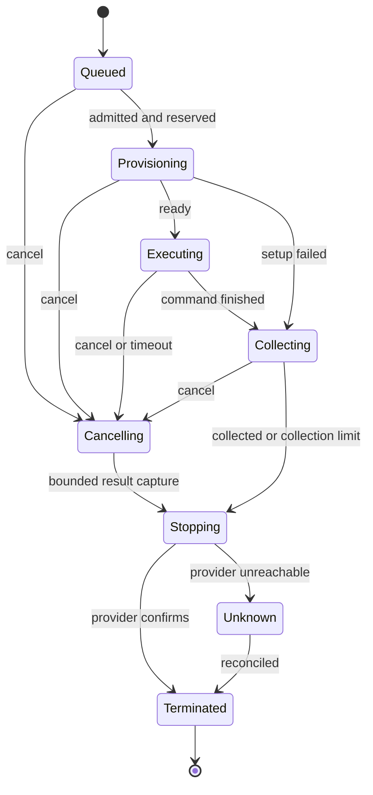

# Shared execution runtime

Status: proposal for the [task model](configuration.md). Runtime internals are
host responsibilities, not extra project configuration objects.

## One task per run

A run freezes the task ID, command, definition, input revision, image, size, timeout,
file globs, test expectations, and grants. The host creates a fresh isolated
container, executes the command, collects results, and destroys the container.
An ordinary shell command or project script can perform several operations internally.
There are no user-defined step records, dependencies, or paused agent decisions.

The agent works between runs. It inspects logs and retained changes, repairs files
or task settings, and starts another finite attempt. It cannot attach, append
commands, extend a deadline, or keep an environment alive while reasoning.

Internal durable records include the run and its sandbox allocation. Lifecycle
phases such as setup, command, collection, and shutdown help observation; they are
not configurable workflow steps. Retry means a new run ID and fresh filesystem.
GitHub sync uses a trusted handler without a container. File-only LLM verification
uses no container either. Compiler sessions can link several runs.

## One contract, several adapters

The host injects capabilities to discover supported environments, submit a frozen
run, read state/logs/results, and cancel. Requests and receipts are serializable.

| Entry point | Execution |
| --- | --- |
| Local CLI/GUI | Local Docker/Podman with a project copy by default. |
| Coding agent using MCP | Same task tools and local adapter, or explicitly selected hosted execution. |
| IDE using ACP | Same tools injected through `jazyk acp`; no IDE terminal required. |
| Cloud | Managed isolated execution with service-held credentials and account admission. |
| Browser-only project | No executor until connected to a local engine or hosted service. |
| Explicit trusted native mode | Bounded process in a fresh directory, with host privileges and weaker isolation shown. |

Client transport and execution location are independent. Local use needs no Cloud
account. Cloud compute requires authentication and allowance through any client.
Provider choice is host configuration; projects carry command/image intent. Record
platform differences, including local ARM versus hosted x86. See [access](access-paths.md).

`SessionRunner` runs model sessions, not containers. Keep hosted subprocess denial
in `sys::run_shell`. Dispatch through the injected capability, never the API host's
shell. A missing adapter returns `runtime-unavailable`.

Submission returns a durable run ID promptly. Waiting uses bounded cursor reads.
Do not hold an HTTP request, database transaction, or MCP/ACP tool invocation open
for a whole build. Supervisors survive client/session loss. Recover an existing run
by ID after a crash instead of rerunning a lost tool response.

## Snapshot and import

Freeze documentation, source, tests, optional scripts, assets, settings, and a
read-only projection of relevant `.jazyk` data. Exclude credentials, Git internals,
conversations, other projects, and provider state. Git-dependent commands use an
explicit supported checkout capability without inherited credential-bearing config.
A bare snapshot plus the command `git push` does not imply a working Git checkout.

Compiler state is read-only or exported under `/jazyk/input`. The sandbox never
writes authoritative graph shards or ledger state. Do not bind-mount the API server
or actual user checkout as writable. Materialize staged generation edits when the
run targets a staged revision.

Restore permitted disposable cache, then execute the exact command. Collect a
bounded change manifest and reports afterward. Import through existing ownership,
fact-hash, and revision gates. Concurrent edits cannot mutate the frozen input or
be overwritten by stale results. A shell-written settings file cannot bypass the
restricted task-settings tool. Logs and retained changes survive container teardown.

## Lifecycle

Execution outcome, collection completeness, and confirmed termination are distinct.
Queue cancellation without an allocation can terminate immediately. During stopping
or unknown shutdown, another cancel call reasserts stop intent and returns current
state. Terminal outcomes include succeeded, failed, cancelled, and timed out.

Persist intent before dispatch/stop. Use operation IDs and provider idempotency;
where unavailable, tag resources and reconcile before retrying. A lost start response
must not allocate twice. Unknown publication is inspected, not automatically repeated.

## Cancellation

Users and authorized agents can cancel at any time while a run is active. This
includes image pulls/setup, executing commands, result collection, and shutdown.
Cancellation does not depend on the command returning or model responding.

1. Persist stop intent atomically. A queued run becomes undispatchable. A concurrent
   allocator that returns late sees the intent and terminates its allocation.
2. Stop accepting further command work. Signal the entire process group/tree and
   allow a short bounded grace period, then force-terminate the container/allocation.
   Shell traps and detached children cannot veto shutdown. Abort image preparation
   when supported; reconcile and stop resources created during the race otherwise.
3. Retain already streamed logs and a bounded best effort of reports/eligible diffs.
   Result capture must not extend the shutdown bound. Mark incomplete collection;
   cancellation during collection stops further promotion. No new cache is saved.
4. Confirm provider termination and reconcile billing. Keep `cancelling` or
   `shutdown unknown` visible until evidence supports completion. Never claim zero
   remaining cost just because the application sent a stop request.

Cancellation is idempotent, allowed after usage exhaustion, and available separately
from submitting work. Cancelling an already completed run returns its final state.
The completion/cancel race has one atomic finalization point: a prior committed
completion wins; otherwise accepted cancellation prevents successful finalization
and further product promotion. Already committed files or external writes remain.

Cancellation cannot roll back a push, upload, publication, or notification already
performed. Track a known external receipt or an unknown outcome separately from the
cancelled run. Never automatically retry such an operation. A no-container GitHub
sync also checks stop intent before starting each external request; an in-flight
remote write may still complete and must be reconciled.

Valid completed test cases can retain their evidence. Interrupted or absent cases
do not pass. Keep historical results distinct from this attempt's missing evidence.
See [verification](generation-testing.md#selection-and-results).

Cloud UI, MCP `cancel_run`, ACP-owned session cancellation, and CLI stop all route
to this supervisor. Disconnect alone does not cancel unrelated work. Parent
ownership determines which child runs an explicit session/job cancellation stops.

## Fixed bounds and cleanup

Proposed default execution timeout is five minutes. Longer requests such as 30
minutes are chosen before submission; a provisional host cap is two hours. These
values need measurements. No log poll, command subprocess, or agent call resets
the fixed deadline or increases resources mid-run.

Admission bounds queueing, setup, command, collection, and shutdown separately.
Queue waiting consumes no sandbox allocation charge. Reserve supplier-billable
setup/collection/shutdown as well as command time. On allocation, use a provider
maximum lifetime and a stricter host phase watchdog where supported.

Where the provider has no enforced total lifetime, use an independent watchdog with
measured worst-case exposure. An API-process timer alone is insufficient. An
external reaper reconciles allocations and shutdown. Retain reservations until
confirmed termination or evidence-backed billing reconciliation.

Success, failure, timeout, cancellation, agent disconnect, and collection errors
all reach teardown. A script's cleanup hook cannot hold a container indefinitely.
If the provider kills it before final collection, label retained changes incomplete.

## Resources and concurrency

Expose a few resource classes with exact CPU, memory, disk, and estimated rates.
The model requests an admitted class before starting. Hard limits, including burst
behavior, must support the stated cost bound. OOM does not silently resize a run.

Recommend one active run per project initially. Different projects can run in
parallel within service/account limits. A compiler worker awaiting its child run
must not occupy the runtime slot the child needs. Future concurrent runs keep
separate writable copies and revision-checked imports.

A command can start test helper processes inside its permitted environment. The
supervisor terminates them when the command ends. Live filesystems and processes
never become canonical project state. Later tasks rebuild or use durable products
and disposable cache; they cannot resume a previous process.

## Isolation boundary

Managed isolation is preferred. No boundary is literally bulletproof. Ordinary
Docker on the API server is not an acceptable untrusted customer sandbox.
[Docker security guidance](https://docs.docker.com/engine/security/) describes daemon
privileges and isolation limits. Rootless mode alone is not an escape-proof boundary.

The adapter must enforce no host mounts/socket, privileged mode, host networking,
or routes to metadata, the control plane, tenant databases, or other tenants.
Bound CPU, memory, disk, processes, logs, uploads, and network use. Test services
stay private. Transfers use project-scoped expiring grants, not provider credentials.

Dependency installation and image preparation are untrusted too. Isolate and meter
them. Publication credentials are absent unless granted; narrow their scope and
lifetime. Separate publication tasks are useful when build code should have none.
A description cannot constrain what arbitrary shell code does with a broad secret.

Logs, reports, filenames, and artifacts are untrusted data. They cannot expand
permissions. Redaction reduces accidental leakage but cannot prevent a malicious
command with a credential from exporting it.
