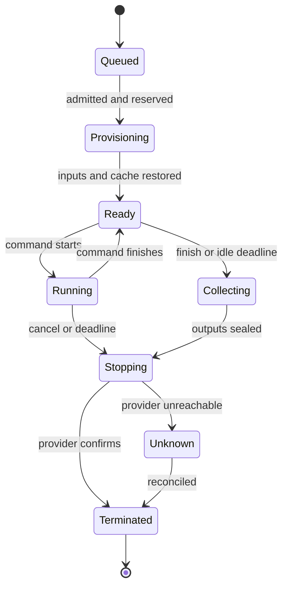

# Shared execution runtime

Status: proposal. See the [overview](README.md) and the
[agent tools and prompts](agent-contract.md).

## Three records

- A run is a durable user or agent operation: generate, verify, deliver, or explore.
  It owns input revisions, steps, logs, products, evidence, and usage references.
- A sandbox is a disposable environment with a provider ID, image digest, resource
  class, lease, and filesystem. A run may need replacement sandboxes after expiry.
- A command is one invocation in that environment. It has a stable ID, literal
  inputs, deadline, exit status, and output stream. Several commands can reuse one
  sandbox while a run remains active.

A GitHub sync run has no sandbox. A completed run stays visible after its sandbox
is gone. Restart creates a new attempt and environment. It does not pretend that
dead processes or unretained files still exist.

## One contract, several adapters

Add a shared runtime capability supplied to the engine by its host. It covers
capability discovery, opening an environment, starting commands, reading events,
reading files, collecting outputs, cancellation, and termination. It uses serializable
requests and receipts so MCP, CLI, ACP, and the editor observe the same work.

| Host | Adapter | Credentials and policy |
| --- | --- | --- |
| Local CLI or local GUI | Docker/Podman in a disposable project copy | Local host settings and credential grants. |
| External coding agent over MCP | Same local adapter through Jazyk tools | Harness commands remain available, but runtime receipts establish Jazyk evidence. |
| Cloud | Managed sandbox service | Server-held provider credentials, account admission, metering. |
| Browser-only project | No execution adapter by default | Connect a local engine or explicitly use Cloud runtime service. |
| Trusted local mode | Direct host process in a task directory | Explicitly weaker isolation, opt-in, never used as a silent fallback. |

Provider configuration is not in portable project settings. A Cloud project that
exports locally carries image and script intent without Cloud credentials. A local
project uses the same script, working directory, file manifest, and report mapping.
Record architecture differences such as local ARM versus hosted x86. Image equality
does not guarantee byte-identical output across platforms.

The existing `SessionRunner` is the model-session interface, not the container
interface. Keep that distinction. Hosted execution must never remove the guard in
`sys::run_shell` and then call the API host shell. Dispatch through the supplied
runtime capability instead. No capability means `runtime-unavailable`.

Long commands return IDs promptly. An engine session can await bounded status calls
on its worker thread while retaining its session context. HTTP requests, database
transactions, and event-stream permits are released normally. Runtime operations
are durable jobs; process restart can recover their status. Do not promise model
session continuation after a crash until its pending tool result and session state
are persisted. The initial recovery can end that session and let the next compiler
session inspect its completed command receipt.

## Snapshot and import

Opening a sandbox materializes a versioned project manifest: documentation, source,
tests, scripts, required products, and a read-only projection of `.jazyk` state.
Exclude credentials, Git internals, conversations, other projects, and provider
state. A command that needs Git metadata must request an explicit checkout mode;
do not copy a credential-bearing `.git/config` by default.

Compiler state has a read-only mount where supported, or a read-only export under
`/jazyk/input` with paths recorded in the manifest. A mutable copy inside a sandbox
is never accepted as authoritative graph or ledger state. The provider adapter
must not expose a writable mount of the API server or the user's actual checkout.

Generation writes remain staged engine files. Before a command, the harness uploads
the current staged revision. Afterward it computes a bounded diff against that
revision. Source/test/support-file changes re-enter through their existing ownership
and fact-hash gates. Settings changes use the restricted settings tool. Products use
the retention contract. A shell script cannot bypass these gates by writing files.

If edits happened elsewhere, import uses expected revision checks. A conflict retains
the run's files as a reviewable result. It does not overwrite the editor's newer
files. A delivery starts from a frozen committed candidate by default. Exploratory
and generation runs can use staged candidates, labeled as such.

## Lifecycle

Persist the intent before an external create, exec, or stop request. Use stable
idempotency keys where supported. If a provider lacks idempotent creation, tag the
resource with the operation ID and reconcile before retrying. Uncertain creation
must not allocate another billable sandbox blindly. The same rule applies to an
exec that might already have published externally.

Report terminal command outcomes separately: success, assertion failure, setup
failure, timeout, OOM, cancellation, and infrastructure failure. `Unknown` is an
operational state, not success or confirmed shutdown. Keep tracking exposure until
termination is established or reconciled by an operator with provider evidence.

## Time limits and renewal

Use three clocks. Proposed values are starting points to benchmark.

| Bound | Proposed default | Renewal |
| --- | --- | --- |
| Command deadline | 5 minutes; an admitted command may request 30 minutes | Agent explicitly extends a running command if policy and budget permit. |
| Idle expiry | 2 minutes after the last command completes | Starting another command resets it. Reading logs or heartbeat traffic does not. |
| Absolute sandbox lifetime | 2 hours, capped by provider capability | Cannot be reset by commands. A new sandbox restores retained state. |

An active 30-minute command is not idle. It may run to its admitted command deadline
even if the last user interaction was much earlier. An independent supervisor kills
the process tree at the deadline. If descendants cannot be proven stopped, destroy
the sandbox. A timeout defaults to terminating that sandbox, then collecting what
is safely available; continuation in a contaminated process tree is not promised.

At command completion, capture the authorized source diff and declared successful
checkpoints before starting the idle clock. A slow model response may outlast that
clock. The next command then opens a replacement from retained state and cache.
Unclassified scratch is intentionally lost. The tool response warns when a useful
unretained file would disappear, so the agent can declare it before continuing.

Each command or extension reserves its worst-case additional cost before dispatch.
The effective deadline is bounded by command policy, sandbox absolute lifetime,
provider lifetime, and admitted spend. An agent sees the effective deadline in the
tool response. Asking for more time is not permission to exceed any of these.

The user example becomes: open, run for at most five minutes, finish after one,
inspect, start another command for five minutes, then stop. The second command's
deadline starts now. It does not inherit four unused minutes or reset the absolute
lifetime. A 30-minute command requests and reserves that duration explicitly.

Provider-enforced lifetime is a final bound. A service watchdog renews short funded
leases where supported and an independent reaper reconciles expired resources.
For a provider whose maximum lifetime is fixed at creation, budget admission must
cover the possible orphan exposure to that maximum or use short-lived replacements.
Do not assume an application timer alone caps a provider bill after a service crash.

## Resources and concurrency

Expose a small catalog, initially `small`, `medium`, and `large`, with exact CPU,
RAM, disk, and estimated usage rate. The agent chooses the smallest credible class.
There is no automatic paid escalation after an OOM. A replacement request names
the evidence and revised bound, and policy determines whether it is admissible.

Define classes in portable vCPU and memory terms; adapters resolve provider units
and enforce hard limits. A CPU reservation that can burst to an unbounded bill is
not a cost ceiling. Unsupported shapes return available alternatives explicitly.

Start with one live sandbox per project, one foreground command, and one controlling
actor. This does not serialize all projects or change compiler session scheduling.
Multiple tenants and projects have independent sandboxes. Parent compilation plus
its sandbox counts as one user operation, while consuming separate internal model
and runtime capacity. Avoid a concurrency deadlock where a job uses the only slot
and cannot start the sandbox it needs.

A separate publish environment can still respect the one-sandbox limit: seal the
build outputs, terminate the build sandbox, then open the credentialed publisher.
An interactive agent run does not silently prevent a user delivery forever; the
UI offers queue, stop, or a controlled handoff.

Tests may start bounded helper processes such as a database in their sandbox if
supported. The supervisor owns their cleanup. Multi-container service groups and
parallel independent runs are a later capability with aggregate cost accounting.
When introduced, every run still gets its own writable snapshot and cache staging
area, with one revision-checked import into the project.

## Isolation boundary

Managed isolation is preferred. No boundary is literally bulletproof. Ordinary
Docker on the API host is not an acceptable customer sandbox recommendation.
[Docker documents](https://docs.docker.com/engine/security/) the consequences of
daemon access and incomplete isolation. Rootless mode mitigates daemon privileges;
it is one defense, not an escape-proof multi-tenant boundary.

The provider adapter must provide or enforce:

- No host mounts, Docker socket, privileged mode, host network, or host namespaces.
- CPU, memory, disk, process-count, output-size, upload, and network budgets.
- No routes to the control plane, tenant databases, host metadata, or other tenants.
- No inbound public service by default. Any preview tunnel is authenticated and
  tied to the sandbox lease, not permanent hosting.
- Project-scoped, expiring transfer credentials. Never give the project a general
  object-store key or provider control-plane credential.
- Separate uncredentialed build/test and credentialed publish environments, unless
  the user deliberately grants a broader execution scope. A later shell must not
  inherit publication secrets from an earlier command.

Dependency install scripts and selected images are untrusted execution too. Image
preparation belongs in the isolated provider environment. Support ordinary public
egress for dependency retrieval under policy, with private/metadata addresses
blocked. Narrow publishing credentials and destinations separately. Arbitrary shell
plus a broad token cannot be made harmless by a prompt or a label.

Logs, test reports, filenames, and generated artifacts are untrusted model input.
They cannot grant capabilities, change budget policy, or direct control-plane tools.
Secret redaction reduces accidental leakage; it cannot guarantee a malicious script
with a secret will not encode and export it.
