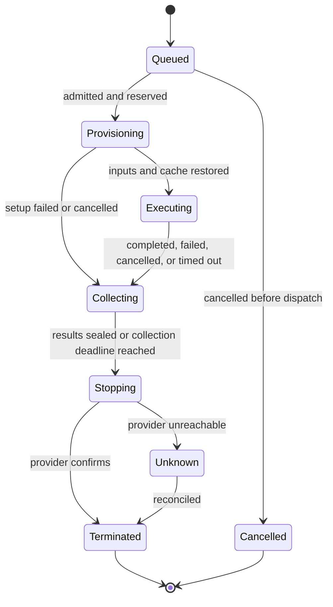

# Shared execution runtime

Status: proposal incorporating the owner's finite-run decision. See the
[overview](README.md) and the [agent tools and prompts](agent-contract.md).

## One action per run

A run freezes one action, its input revision, test selection, image, resource size,
timeout, retention rules, and grants. The host creates a fresh isolated container,
executes the complete script or ordered steps, captures results, and destroys the
container. A script may invoke any number of commands internally. Those commands
are part of the action, not new instructions sent into a running environment.

The agent works between runs: inspect retained logs and file changes, repair files
or scripts, then launch another finite run. It cannot attach a shell, append steps,
extend a running deadline, or keep an environment alive while deciding what to do.
A run may be cancelled. Finishing, failure, or cancellation always leads to bounded
collection and teardown without another agent call.

The durable records are:

- A run: frozen action and candidate, state, logs, file changes, evidence, usage.
- A sandbox allocation: provider identity, image digest, resources, hard deadline,
  and confirmed termination. One allocation per execution attempt in v1.
- A step: an invocation from the frozen action, with identity, status, and output.
  A single-script action has one execution step. Arbitrary subprocesses are not
  individually controllable user or agent operations.

A GitHub sync run has no container. An LLM-only verification operation needs none
when its artifacts already exist. A compiler session can link several finite runs.
A retry creates another attempt with its own ID and environment; the previous
attempt's files and process state are not a live machine to resume.

## One contract, several adapters

The engine receives a runtime capability from its host: discover supported actions
and environments, submit a frozen run, read state/events/logs/results, and cancel.
Requests and receipts are serializable so MCP, CLI, ACP, and the editor observe the
same work. There is no general-purpose remote exec or terminal endpoint.

| Host | Adapter | Credentials and policy |
| --- | --- | --- |
| Local CLI or local GUI | Docker/Podman, fresh container and project copy per run | Local host settings and credential grants. |
| External coding agent over MCP | Same finite-run tools | Harness-native shell remains external to this contract; Jazyk evidence comes from recorded runs. |
| IDE using ACP | Same tools injected through `jazyk acp` | Existing IDE/agent permission handling plus the run host's grants; no terminal needed. |
| Cloud | Managed isolated batch execution | Server-held provider credentials, account admission, metering. |
| Browser-only project | No execution adapter by default | Connect a local engine or explicitly use Cloud execution. |
| Trusted local mode | Bounded host process in a fresh task directory | Explicitly weaker isolation, opt-in, never a silent fallback. |

Provider selection belongs to host settings. Exported projects carry image and
script intent without Cloud credentials. Local and remote runs use the same
working-directory, manifest, report, and import contracts. Record platform
information; local ARM and hosted x86 may produce different artifacts.

Client transport and execution location are independent. Cloud, local MCP, and ACP
share admission, operation IDs, receipts, and cancellation semantics. See
[access paths](access-paths.md) for routing, IDE presentation, and disconnections.

The existing `SessionRunner` runs model sessions, not containers. Hosted code keeps
its direct subprocess guard in `sys::run_shell`. A run dispatches through the host
capability, never through the API host shell. Missing capability is an explicit
`runtime-unavailable` result.

Submission returns a durable run ID promptly. Waiting is bounded and resumable by
cursor. No HTTP request or database transaction stays open for the whole action.
A compiler worker may await the result while retaining session context. After a
service crash, recover the run independently. Until model-session persistence can
resume a pending tool result, end that session and let the next one inspect the
retained run. Never repeat execution just to reconstruct a lost tool response.

## Snapshot and import

Submission freezes documentation, source, tests, scripts, relevant binary assets,
and a read-only projection of `.jazyk` state. Exclude credentials, Git internals,
conversations, other projects, and provider state. A script requiring Git metadata
uses an explicit checkout mode without copying credential-bearing local Git config.

Mount compiler state read-only where supported, or export it under `/jazyk/input`.
A mutable sandbox copy is never authoritative graph or ledger state. There is no
writable bind mount of the API server or the user's actual checkout.

Generation edits staged engine files before submitting a run. The host materializes
that candidate, restores allowed caches, then runs the frozen action. Afterward it
captures a bounded file-change manifest relative to the input, retains eligible
contents, and imports through existing ownership/fact-hash gates. Settings changes
use the restricted settings tool between runs. A shell write cannot bypass gates.

A delivery normally uses a committed candidate. Generation can run a staged one,
labeled as such. Concurrent editor changes do not alter a running snapshot. Import
conflicts retain the result for review instead of overwriting newer source. Logs
and file changes remain readable after container teardown.

## Lifecycle

Execution outcome, collection outcome, and termination are separate fields. A
successful script can have a failed product import. A failed test can retain a
successful build-cache checkpoint. A process exit is not confirmed provider shutdown.

Persist intent before dispatch and stop requests. Use stable operation IDs and
provider idempotency where available. Otherwise tag resources and reconcile before
retry. A lost create/start response must not launch a second potentially publishing
run. Unknown external effects require inspection, not automatic script repetition.

The fixed executor runs declared steps sequentially without pausing for an LLM.
By default, step failure skips dependent remaining execution, then collects logs,
reports, and permitted failure artifacts. Declared cache saves occur at successful
boundaries, e.g. between build and test. Teardown is always the host's responsibility,
even if the script's own cleanup fails.

## Fixed limits and teardown

Proposed execution timeout: five minutes by default, with longer requests such as
30 minutes chosen before submission. The host may permit up to two hours initially,
subject to provider and account policy. These are values to benchmark, not decisions.
Step timeouts may shorten the overall bound; they cannot reset or extend it.

Admission includes separate bounded setup, execution, collection, and shutdown
allowances. On allocation, establish a provider-enforced maximum lifetime covering
all admitted phases and a host watchdog for the stricter phase deadlines. Record
effective deadlines in the run. Queue waiting has its own expiry and no allocation
charge. The candidate remains frozen while queued.

Neither the agent, a user, nor log polling can extend a running deadline or change
its resource class. If a build needs more time or memory, finish/cancel this attempt,
revise the next request, and submit a new run when retry is safe. The remaining
session/account budget also bounds repeated attempts.

On timeout or cancellation, stop the process tree, capture bounded available
results, and terminate the environment. Detached children never keep it alive after
the action ends. Reserve collection and shutdown time in advance. If the provider
kills the container before collection, retained logs/checkpoints remain available
and the final diff is explicitly incomplete.

Provider expiry is a final bound independent of API health. An external reaper
reconciles resources and termination. A provider without a suitable enforced
lifetime needs an independent watchdog with a measured worst-case exposure bound.
An application timer alone is insufficient. Keep the usage reservation until
termination or an evidence-backed reconciliation establishes the actual expense.

## Resources and concurrency

Expose `small`, `medium`, and `large` with exact CPU, RAM, disk, and estimated rate.
The agent chooses an admitted class before each run. Hard resource limits matter:
a reservation that permits an unbounded burst is not a billing maximum. Unsupported
shapes return explicit alternatives. OOM never silently increases paid resources.

Recommend one active execution run per project initially. Different projects can
run concurrently within account/service limits. A compiler operation plus its child
run counts as one user operation while consuming independent internal capacities;
it must not deadlock waiting for a sandbox slot consumed by its own parent.

Multi-step actions share the one container until their fixed sequence ends. Builds
can start test helper processes such as a database if the adapter supports them;
the supervisor stops those processes with the run. Parallel runs and service groups
remain later capabilities with isolated writable copies and aggregate admission.

A separate credentialed publisher is another finite run over sealed outputs after
the build run terminates. Cache and product objects may persist between runs. Live
filesystems, processes, terminals, and sandbox snapshots are not project state.

## Isolation boundary

Managed isolation is preferred. No boundary is literally bulletproof. Ordinary
Docker on the API host is not an acceptable customer sandbox recommendation.
[Docker documents](https://docs.docker.com/engine/security/) the consequences of
daemon access and incomplete isolation. Rootless mode is one defense, not an
escape-proof multi-tenant boundary.

The provider adapter must provide or enforce:

- No host mounts, Docker socket, privileged mode, host network, or host namespaces.
- CPU, memory, disk, process-count, output-size, upload, and network budgets.
- No routes to the control plane, tenant databases, host metadata, or other tenants.
- No inbound public access. Test services stay inside the run's permitted network.
- Project-scoped expiring transfers, never general object-store/provider credentials.
- Separate uncredentialed build/test and credentialed publish runs unless the user
  deliberately grants broader scope. Teardown also removes those credentials.

Dependency installation and image preparation are untrusted execution too. Isolate
preparation and include its bounds in admission. Allow dependency retrieval according
to policy while blocking private/metadata routes. Narrow publication credentials
separately. Arbitrary scripts with broad credentials cannot be made harmless by a
prompt or label.

Logs, reports, filenames, and generated artifacts are untrusted model input. They
cannot grant capabilities or change policy. Redaction reduces accidental leakage;
it cannot guarantee that a malicious script given a secret will not export it.
