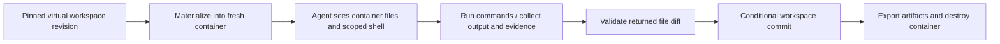

# Optional execution environments

Revised 2026-10-02. A cloud project no longer means a long-lived project container.
Compilation runs on the [shared Jazyk server](./server.md) through virtual storage.
This page now covers only work that needs an actual execution environment.

## What needs a container

| Operation | Shared server with virtual storage | Isolated execution environment |
|---|---|---|
| Parse, reconcile, check graph, render supported diagrams | Yes | No |
| Generate source or test text through virtual tools | Possible after defining artifact-only gates | No, if the agent needs no native commands/files |
| Package installation, shell, build, run tests | No | Yes |
| Agent that requires native project files or terminal tools | No | Yes for hosted customer work |
| Preview a generated application | No | Yes, through a separate preview origin |
| Deployment build or migration command | No | Yes; production hosting is a separate target |

Container means a provider-supported isolated execution environment. Select the exact
boundary and limits from [the global provider research](./sandboxes.md) when this
milestone begins. An ordinary process with a different cwd is not tenant isolation.

## Lifecycle

1. Create a job bound to tenant, project, base source revision, graph generation,
   compiler/tool versions, an idempotency key, and spend/resource limits.
2. Materialize selected source, generated artifacts, and declared data into a fresh
   environment from a trusted image. Files come from the virtual workspace adapter,
   including local-remote or GitHub sources. No shared host checkout is needed.
3. Mount no other customer data, platform keys, or host directories. Give the runtime
   short-lived access to only its input/output objects and the approved model route.
4. Issue an environment capability. All execution-mode file tools and shell commands
   use that container. The AI now sees the realized files there. Keep graph mutation
   tools bound to the project's gated state, not a second writable graph in the box.
5. Stream bounded stdout/stderr, status, resource usage, and permission questions through
   the existing ACP/project event path. Enforce time, process, CPU, RAM, disk, network,
   and output limits outside the guest.
6. Collect exit status, exact tested source digest, toolchain/image version, artifacts,
   and proposed file diffs. Treat runtime output as untrusted data.
7. Reacquire project write authority for import. Compare the base revision and allowed
   paths; validate patches through the workspace coordinator. A moved source head
   creates a reviewable conflict, not an overwrite or a silently rebased pass result.
8. Persist accepted artifacts/evidence and settle actual usage. Revoke capabilities
   and destroy the container. Cleanup retries by execution id after service failure.

Keep the project available for reading and, where safe, source editing while execution
runs. The result is evidence for its recorded revision. New edits make it stale rather
than invalidating the new edits. Serialize the eventual graph/source commit.

A connector loss during local-backed execution prevents local import. Retain evidence
under a disclosed bounded recovery policy or cancel the job; do not claim files are
saved locally before the connector acknowledges them. Never extend runtime indefinitely
while waiting for a sleeping computer.

## Tool and credential boundary

- Platform Stripe, account, database, GitHub App, and provider master credentials stay
  outside the container. Per-job capabilities bind project, run, scope, expiry, and cap.
- Secrets that generated code actually consumes can be read by that code. Use explicit,
  narrowly scoped test credentials and a separate deployment secret mechanism.
- Project setup hooks and dependencies run only inside the same isolation boundary.
- Restrict network access using provider facilities. Metadata/platform endpoints and
  cross-tenant storage remain inaccessible. Registry access does not imply safe packages.
- Do not copy an arbitrary container root, hidden credential files, devices, or escaping
  symlinks into storage. Import only allowed outputs and user-visible diffs.
- Do not let an agent alternate silently between the virtual source and a stale
  materialization. Its active file environment must be explicit in tools and UI.

## Generation and test status

Source/test generation can be split from execution, but the existing ledger contracts
must be updated first. If today's goal gate requires running a build or verification,
removing the shell cannot make that gate pass.

Represent artifact production, execution required, executed result, and stale evidence
separately. A model's statement that tests pass is not execution evidence. An execution
requirement may park a task until an environment is authorized. Do not report full
verification or convergence by silently dropping required execution goals.

The initial hosted product may stop at compilation and graph output. Artifact-only
generation is the next optional increment. The execution milestone unlocks generated
program builds, actual test runs, and agent workflows that require a real filesystem.

## Deployment

Deployment is a separate operation using an explicit destination and its credentials.
A build container may create and publish an artifact; it is not automatically the
production application host. Persistent databases/uploads require their own hosting
and backup policy. Do not turn an expiring execution container into production by
leaving it running.

Preview access uses a separate origin and scoped authorization. Deleting a preview
must not delete the source workspace. Long-lived previews and production hosting
need separate pricing and lifecycle work after the compilation service.

## Billing and provider selection

No container charge is attached to ordinary cloud project reads or compilation.
Reserve execution spend when a job starts, enforce a hard cap, and settle from trusted
runtime/provider observations. Show it separately from model usage even if both consume
one prepaid wallet. Waiting for a model can still consume container resources.

The previous E2B/Vercel/Daytona comparison remains useful for these jobs. Its costs do
not price the shared compiler service. Test materialization latency, command control,
network boundaries, output collection, conflict handling, and cleanup before choosing.
Do not make this selection a prerequisite for launching compilation-only cloud access.
