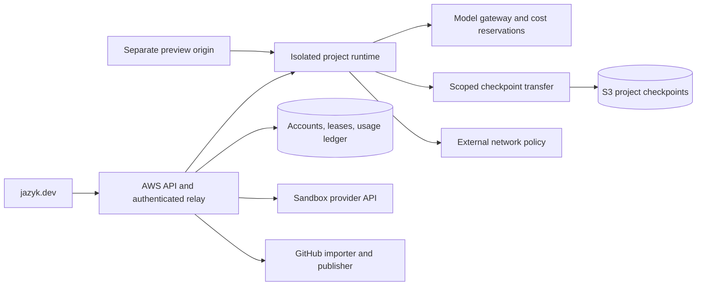

# Cloud sessions

A cloud session runs the full Jazyk binary in an isolated project runtime. The page
connects through the trusted platform. A project can compile, generate a deliverable,
run builds/tests, preview a web product, and export its work. Local use remains a
separate, fully usable path.

See [providers](./sandboxes.md), [storage](./storage.md), and
[compiler boundaries](./boundaries.md). Cloud behavior belongs in `docs/cloud/` and
web behavior in `docs/web/` when implemented.

## Architecture

The platform is trusted. The entire project runtime, including its Jazyk binary,
files, dependencies, and generated commands, is untrusted. A path check inside the
binary does not provide a tenant isolation boundary.

One runtime owns one project workspace. Different projects can run concurrently;
each project's compiler retains its single build lease and sequential sessions.
The cloud does not derive, store, route, or prioritize compiler goals.

## Credentials and network

- Provider API keys, Stripe secrets, GitHub App credentials, and account-wide storage
  permissions never enter the runtime.
- A managed-model credential is short-lived and restricted to this project, runtime
  lease, account allowance, and spend envelope. Assume malicious guest code can
  obtain or use it. Its scope and server-side metering bound the damage.
- Use provider credential injection/brokering where available. Do not rely on an env
  scrub or a different Unix user as the only barrier to platform secrets.
- Use separate credentials for relay access, model calls, and checkpoint transfer.
  Revoking the runtime lease revokes all of them. No one token authorizes everything.
- A customer's product secret used by generated code can be read or exfiltrated by
  that code. Supply only narrowly scoped test credentials, with explicit user choice.
  Do not promise that the harness can hide a secret from code that must consume it.
- The first cloud beta uses managed AI, per the [workflow scope](./workflows.md).
  Defer cloud BYOK. A later supported-provider integration can start with OpenRouter,
  keeping long-lived customer keys encrypted outside the runtime. A laptop endpoint
  is not reachable merely because it works locally; private tunnels are later work.

Enforce egress outside the guest. Start with the model gateway, scoped storage
transfer, and a maintained set of required package endpoints. GitHub access goes
through the integration. A user can request additional destinations for the project.
Use the provider's policy features or an established proxy, not a bespoke TLS/Git
protocol implementation.

Block metadata and private-platform destinations, direct bypass paths, and outbound
mail. Test DNS/IP/IPv6 behavior. A permitted registry or GitHub domain can still carry
malicious packages or data; an allowlist reduces exposure but does not eliminate
exfiltration. Do not automatically sell unrestricted internet as a higher-tier perk.

## Portable process limits

Before cloud beta, specify and implement limits across every command path:

- `run_command`, build commands, verification/test runners, setup commands, and
  external ACP subprocesses.
- Wall time, output bytes, process count, CPU/memory/disk, and cancellation.
- Terminate process groups and descendants on timeout/cancel using platform libraries.
- Bound output while reading it; truncating after `.output()` does not bound memory.
- Separate environment setup from project execution and pass only needed environment
  variables. Untrusted setup hooks receive the same network/resource policy.

Project runtime resource limits remain externally enforced if the guest ignores
its own command timeouts. Test runaway output, forked children, disk exhaustion,
unresponsive processes, and a cancelled build. These changes also benefit local use.

## GUI integration

Add a cloud backend beside the existing local-server and browser paths. Reuse the
capability descriptor and project API. Unsupported operations remain explicit.
The page gains account/project selection and runtime/backup/usage status.
Use the common project picker with `Runs on`, `Saved in`, and `AI`. A subscription
change does not move the project. Changing its home is an explicit export/import.
Native local ACP/LSP support remains. Remote cloud IDE attachment is later work.

The relay checks account/project ownership, active lease, origin, and connection
credentials. It proxies the web editor's project API, SSE, and any required LSP
WebSocket with reconnect and bounded idle handling. This does not expose a remote
ACP/IDE service. The raw provider URL must not bypass access control.

The runtime launcher configures headless serving and relay authentication using a
generic remote-server contract. Avoid teaching the core binary about E2B, Stripe,
or subscription tiers. Document necessary serving options in the portable frontend
spec before implementation.

A user action starts/resumes compute after its rate and payment source are known.
Merely listing projects, health-checking the service, or loading a stale preview
must not start an unbounded paid runtime.

## Lifecycle and leases

Persist runtime lifecycle in the cloud database. This is orchestration state, not a
stored compiler goal board.

1. Create/import: choose the source mode, verify entitlement, and create a project
   record. No sandbox is required just to hold an inactive project.
2. Start: atomically acquire a project lease with a monotonically increasing fence,
   reserve compute, and create/resume a runtime with bounded provider lifetime.
3. Restore: validate the selected checkpoint/image and inject fresh scoped tokens.
   Run versioned setup and restart necessary services. Do not reuse old snapshot tokens.
4. Work: the compiler owns its graph/build lease. Keep running after the browser
   closes if an authorized job is active, within budget and time limits.
5. Checkpoint: request a consistent durable project version, with visible backup
   status. See [save semantics](./storage.md#save-and-recovery-semantics).
6. Stop: finish/checkpoint at a safe boundary if possible, terminate jobs after the
   bounded grace, and stop/pause through the provider API. A process existing is not
   automatically proof of active user work.
7. Reconcile: independently inspect provider inventory. Recover interrupted create,
   stop, and delete jobs; close orphaned runtimes and stale reservations.
8. Delete: revoke tokens, terminate runtime, and remove provider snapshots, S3
   versions, and secrets through a retriable retention-aware job.

Use an initial five-minute idle target when there is no connected user, active job,
or deliberate preview activity. Revisit from measured usability/cost. Place a hard
maximum lifetime on every runtime; renew only against paid budget. Keep a separate
maximum for unattended work, proposed at two hours initially. Long jobs can receive
an explicit higher budget later.

The platform lease is authoritative for gateway access, backup publication, and
GitHub publish. Fencing prevents an old VM from overwriting a newer checkpoint or
spending with revoked credentials. Two service replicas must not create two active
writers. Test this under connection loss and service restart.

Paused state can retain memory or only disk depending on the provider. Restarting
processes after restore is acceptable. Paused compute and retained storage have
separate billing semantics; show them separately.

## Compute admission and metering

Reserve a bounded runtime interval before start and renew it while entitled.
Set the provider lifetime below funded time, leaving a measured checkpoint/stop
margin. Never rely only on a cooperative heartbeat from the guest to stop billing.

Measure compute from trusted orchestrator/provider lifecycle and resources, with
idempotent interval records and invoice reconciliation. A provider may continue
billing during stopping or pause transitions; account for that rather than treating
a sent stop request as completed. A provider outage can delay termination. Set a
global exposure cap and alarm on lingering resources.

Model and compute balances are distinct. Exhausting one does not spend the other.
At model exhaustion, stop model work and checkpoint rather than keep an unattended
VM burning its remaining compute. At compute exhaustion, give a bounded stop grace
and preserve the last completed checkpoint even if a current session is lost.

The platform's session view shows running/stopping/paused/error state, balance,
last backup, and stop reason. It does not replace the compiler's semantic verdict.

## Source and product state

Offer cloud-only first and GitHub-backed later as [separate modes](./storage.md#options).
Do not implement automatic `jazyk pull`/`push` or source/graph merging for the beta.
Snapshot `.jazyk/` as persistent state, not a disposable build cache.

The product can run a development database inside the sandbox. Decide whether its
data is disposable or declared durable. Durable data needs consistent backup, size
limits, and a restore test. A memory pause is convenient but insufficient on its own.

Toolchain images are pinned. A changed compiler image must be compatible with the
checkpoint's graph version or use the documented compiler archive/reset behavior
with a retained original checkpoint. Never silently turn a paid project's recovery
into a fresh compilation with new ids.

## Previews and exports

- Run generated app previews on a separate registrable domain from the account UI.
  The exact domain remains unselected. Use an isolated origin per project/runtime.
- Require owner authentication by default. Exchange a short-lived one-use access
  grant for a preview-scoped session; do not send the account cookie or a durable
  gateway token to generated code. Redact tokens from URLs and logs.
- Keep browser origin isolation, CORS, cookies, and embedding policy explicit.
  User apps must not gain access to account UI storage or neighboring previews.
- Do not let public preview traffic auto-resume paid compute. Shared previews and
  public hosting are later features with their own budgets and abuse controls.
- Download artifacts and the portable project archive through authorized, expiring
  URLs. Preserve a useful export when the subscription or cloud entitlement ends.
- This runtime is a development environment. Deploying a production product remains
  separate from the subscription/sandbox launch.

## Beta acceptance

- A generated project builds, tests, previews, and exports in the runtime.
- A malicious project cannot access another account/project or platform credentials.
- Concurrent starts leave one writer; a fenced runtime cannot publish or spend.
- Quota refusal preserves committed graph state and leaves goals resumable.
- VM destruction and restore preserve ids, decrees, diagnostics, and ledger bindings.
- SSE/WS interruption and page closure do not duplicate work or charges.
- Idle timeout, resource exhaustion, provider lifetime, and orchestrator restart all
  lead to bounded compute and recoverable project state.
- Deletion and retention clean up both cloud and provider copies.

These are launch conditions for the actual generated-code execution product, not a
claim that every vendor has already passed them.
