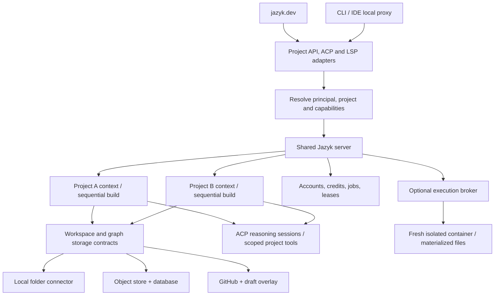

# Shared Jazyk project server

Status: proposed architecture, 2026-10-02. The server hosts the existing persistent,
goal-based compiler. It does not introduce a second compiler or regenerate a graph
for each request. See [storage](./storage.md) and [protocols](./protocols.md).

## Meaning of filesystem-independent

A compiler instance uses project-relative logical paths and versioned storage handles.
It can compile from memory, cloud storage, or a connector without a mounted project
directory. Binaries, certificates, and operational logs are not a project filesystem.

In-process compilation includes parsing, alignment, reconciliation, graph tools,
gates, checks, and supported rendering. It has no customer shell, executable config,
setup hook, native project plugin, or user-specified subprocess command. Uploaded
`jazyk.toml` is data. Hosted agent/provider choices resolve to approved profiles.

The local server uses the same contracts with a local owner principal. It needs no
cloud account database to compile. The hosted wrapper resolves customers and credits
before constructing a project context.

## Project and run contexts

Inject an explicit `ProjectContext` into every operation. Illustrative fields:

- Authorized tenant/project identity and immutable capabilities.
- Workspace handle, source revision, state-store handle, and graph generation.
- Writer epoch, compiler version, and resolved project settings.
- Agent-session factory, model policy, run budget, cancellation, and event sink.
- Trace/artifact sinks and an execution capability absent from compilation.

These are interface concepts, not committed Rust names. Use a context and small
traits. The compiler does not inspect Stripe, account tiers, or sandbox vendor ids.

Move histories, loaded graph sets, provider fallbacks, token meters, pacing, reasoning
settings, and retries into the appropriate project/run/provider context. Share
connection pools only with explicit credential isolation and cache keys. Immutable
payloads and a trusted font database can remain shared. Never use a process-global
active project or a thread-local active tenant as request routing.

Conversation ids, artifact handles, and node ids resolve within a project capability.
The same node id may exist in different projects. Never look up a supplied graph id
globally and infer its project afterward.

## Scheduling

- Allow different projects to compile concurrently. Use a bounded worker pool and a
  fair queue with per-account active-job limits and a global resource ceiling.
- Keep one build lease and one automated batch session per project. Existing goal
  readiness and scheduling rules remain inside that project.
- Use a writer epoch/fencing token, not a process id, as distributed authority.
  Every commit checks the epoch and expected source/state versions.
- A worker losing its lease stops new requests and cannot commit a late model reply.
- Reconnect with a job idempotency key. Duplicate submissions return the same job;
  they do not start another build or grant more credits.
- Keep blocking work off request/event loops. Use bounded compiler threads and
  async adapters or batched prefetch. Avoid network calls for every shard lookup.
- Bound project/graph size, context, queue depth, memory, response size, CPU work,
  retries, and wall time. Release idle contexts after checkpoint.

Only the current writer can commit, including after process failover. One initial
deployable is enough. A reconnect must not depend on reaching the original process.

## Tenant isolation without per-project containers

This is application-level isolation of data processing. It applies only while
customer code cannot execute in the shared server. Prompt instructions and directory
prefixes are not access-control boundaries.

- Authenticate connections and authorize every operation: project reads, reconnect,
  jobs, artifacts, traces, tools, and event subscriptions.
- Construct storage handles from server-owned bindings. Requests cannot choose an
  arbitrary bucket key, repository, credential, SQL scope, or host path.
- Scope database keys, foreign keys, caches, objects, and channels to tenant/project.
  Do not expose a global content-hash existence check as a deduplication oracle.
- Use database row policies as defense in depth. Runtime roles have no owner,
  superuser, or `BYPASSRLS` privileges. Set and clear tenant context transactionally
  on pooled connections. Object storage needs its own authorization.
- Keep tools, files, conversation histories, and credentials private to each project.
  Do not share an external ACP host between tenants unless its caches, histories,
  and filesystem access are demonstrably isolated.
- Tools expose bounded logical reads and gated mutations. They never receive database
  credentials, environment access, arbitrary HTTP fetch, or host shell capability.
- Bound document parsing and rendering. Disable external file/URL includes and use
  controlled assets. Return inert artifacts. Audit native parsing dependencies.
- Keep payloads out of shared logs and crash reports. Private traces need scoped
  retention and export. Revocation closes streams and prevents new work.

PostgreSQL documents that owners, superusers, and `BYPASSRLS` roles can bypass row
security. RLS supplements application authorization and careful pool handling.
Source: [row security](https://www.postgresql.org/docs/current/ddl-rowsecurity.html).

A shared process shares a crash and memory-exhaustion blast radius. Bound and test
adversarial workloads. If a component cannot process untrusted input safely in-process,
isolate that component. Do not claim an absolute no-leak guarantee from Rust alone.
The architecture still does not require a container for every compiling project.

## Database and durable state

Proposed record groups, with the exact schema deferred to the specs:

| Records | Purpose |
|---|---|
| Accounts, identities, memberships, devices | Principals and access; one owner initially |
| Subscriptions, grants, reservations, receipts | Entitlement and idempotent accounting |
| Projects and storage bindings | Source authority, logical root, compiler/state version |
| Workspace/state heads and manifests | Atomic revision and graph-generation references |
| Jobs, writer leases, event cursors | Status, fencing, reconnect, cancellation |
| Provider profiles and secret references | Approved routes without inline secrets |
| Execution jobs and artifact manifests | Optional sandbox lifecycle, evidence, imports |

Keep graph data behind a state-store interface even if manifests share the account
database. Start with existing graph serialization in scoped blobs; do not first
rewrite the semantic graph into relational rows. The compiler owns graph semantics,
goals, gates, and journals. Database adapters own durable storage transactions.

## Job lifecycle

1. Admit the principal, project capability, credit reservation, requested revision,
   and idempotency key.
2. Acquire the writer epoch and open the exact source/state snapshot.
3. Derive goals normally. Stream scoped, sequenced events. Keep infrastructure job
   state separate from semantic convergence.
4. Stage mutations, validate existing gates, and commit through the storage contract.
5. Settle trusted usage observations and release unused reservation.

Cancellation stops new model/tool work and attempts upstream cancellation. Retain the
last acknowledged generation and report incurred charges. Disconnect alone need not
cancel a durable cloud job. A local-backed job stops when its connector is needed for
source or commit authority. See [local-remote](./storage.md#local-remote).

On restart, recover from the last durable generation. Lost acknowledgements must not
duplicate changesets or charges. Reconcile unknown upstream outcomes before retry
where possible; surface uncertainty when the provider supplies no receipt.

## Acceptance gates

- Compile two memory-backed projects concurrently with a test guard rejecting all
  project-related OS filesystem and process calls.
- Use identical filenames/node ids. Neither project can read, mutate, export,
  subscribe to, or infer the other's resources through API or model tools.
- Mixed providers do not alter another project's codec, token count, retry behavior,
  output cap, or cancellation state.
- Stale leases cannot commit. A lost acknowledgement returns the original receipt.
  Concurrent edits retain both versions for explicit resolution.
- Restart the service and recover cloud state and local reconnect correctly.
- Exhaust one project's resource budget while another keeps progressing.
- Passive LSP reads need no inference credits. Credit exhaustion stops hosted model
  work cleanly and leaves accountless local work usable.
- Compilation never materializes a project or launches a sandbox, including through
  an agent's hidden file/shell path. Unsupported agent profiles fail admission.
